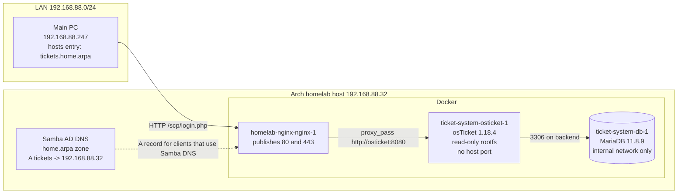
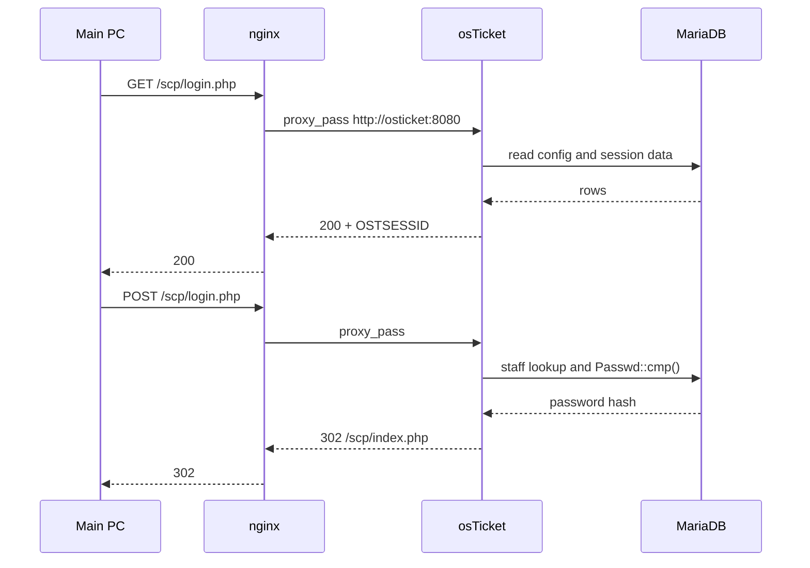

# Homelab ticketing

osTicket 1.18.4 on a small Arch Linux homelab, published through the existing
nginx container at `http://tickets.home.arpa`.

I added a two-container ticketing stack to a host that already ran seven
containers. The application and MariaDB publish no host port, the database is
on an internal Docker network, and the application runs with a read-only root
filesystem. The existing nginx container is the only entry point. HTTPS and
email are deliberately out of scope.

**Status:** working on the private LAN. The agent login has been verified.
LDAP and the osTicket cron worker are not implemented yet. This is a lab
project, not a production deployment. Last verified: 2026-10-21.

## Contents

- [What is running](#what-is-running)
- [Architecture](#architecture)
- [Request path](#request-path)
- [The two sign-in forms](#the-two-sign-in-forms)
- [What I verified](#what-i-verified)
- [Security posture](#security-posture)
- [Problems and fixes](#problems-and-fixes)
- [Run it](#run-it)
- [Repository map](#repository-map)
- [Limitations and next steps](#limitations-and-next-steps)
- [Documentation](#documentation)

## What is running

| Part | Choice |
|---|---|
| Host | Arch Linux, 2 cores, 3.7 GiB RAM |
| Application | osTicket 1.18.4, image `hlhd/osticket:v1.18.4` pinned by digest |
| Database | MariaDB 11.8.9, same Compose stack, internal network only |
| Exposure | existing `homelab-nginx-nginx-1`, HTTP-only vhost on port 80 |
| DNS | Samba AD DNS, `home.arpa` zone, A record `tickets` -> `192.168.88.32` |
| Client | main PC uses a hosts entry for `tickets.home.arpa` |
| Identity | local osTicket admin `homelab-admin`; LDAP is planned |
| Runtime | Docker Compose, read-only app rootfs, file-based secrets |

The image digests are:

```text
hlhd/osticket:v1.18.4@sha256:d115c1a73cafb790ca730e8805178c92484974ceab4f6109dd2a6c71b55e68f4
mariadb:11.8.9@sha256:f16d7a344413e519dff518f27bdb221388f84b0d274c97c4fb5f2cb0dc1b34fa
```

Tags are not trusted on their own. The application image was pulled and
audited before the first deployment; the database image is pinned the same way.
The audit found no malware, no setuid files, no secrets and no shell history.
It did find residual CVE and supply-chain risks, which are listed in
[Limitations](#limitations-and-next-steps) and in
[journal/01-image-audit.txt](journal/01-image-audit.txt).

All addresses in this repository are RFC1918 lab addresses, loopback
addresses, or documentation ranges. They are not reachable from the internet.
Change them before reusing the configuration elsewhere.

## Architecture



The app is attached to two networks: the existing `homelab` network, so nginx
can reach it as `osticket:8080`, and an internal `backend` network for MariaDB.
The database is not attached to `homelab` and has no route to the internet.

The main PC does not use Samba DNS for everything. It has one hosts entry:

```text
192.168.88.32  tickets.home.arpa
```

That was intentional. Replacing the main PC resolver with only
`192.168.88.32` would break normal internet and VPN DNS. The Samba A record is
still useful for clients that already use the DC as their resolver.

The deeper design notes, trust boundaries and failure domains are in
[docs/architecture.md](docs/architecture.md).

## Request path



The nginx block is HTTP only, allows `127.0.0.1`, `172.16.0.0/12` and
`192.168.88.0/24`, and denies everything else. It also sets
`Referrer-Policy: no-referrer` and `X-Robots-Tag: noindex, nofollow`.
The reference vhost is in
[nginx/tickets.home.arpa.conf](nginx/tickets.home.arpa.conf).

## The two sign-in forms

osTicket has separate logins for end users and agents:

| What the user sees | Where it goes | Who it is for |
|---|---|---|
| Top-right **Sign In** | `/login.php` | client portal users |
| **I'm an agent - sign in here** | `/scp/` and `/scp/login.php` | staff |

This distinction caused the longest troubleshooting detour in the project.
The server-side login worked. The user was using the client form with a staff
account, and osTicket returned `Access denied`.

The exact evidence was in the page HTML:

```text
GET /            -> <a href="/login.php">Sign In</a>
GET /login.php   -> I'm an agent ... <a href="/scp/">sign in here</a>
GET /scp/login.php -> agent login form
```

The password was rotated during the investigation. That rotation was not the
fix. The fix was using the agent login at
`http://tickets.home.arpa/scp/login.php` or clicking
**I'm an agent - sign in here**. On the lab host, the current password is the
rotated 20-character value in `compose/secrets/admin_password.txt`; that file is
not in this repository. The old 32-character value is invalid. No password
value is in this repository.

## What I verified

| Check | Result |
|---|---|
| `docker compose ps` | `ticket-system-db-1` and `ticket-system-osticket-1` healthy |
| Published ports | `docker port` empty for both; only nginx listens on 80 and 443 |
| `curl -I http://tickets.home.arpa/scp/login.php` | HTTP 200, correct osTicket agent login title |
| Agent login through nginx | HTTP 200 with JSON `"status":302`; `lastlogin` updated to `2026-10-21 14:06:53` |
| Wrong password and wrong form | `"status":401`, `"message":"Access denied"` |
| DNS | `dig` and `getent hosts` return `192.168.88.32` for `tickets.home.arpa` |
| Existing DNS | `ad.home.arpa` SOA and `dc1.ad.home.arpa` A record still resolve |
| Response headers | no `X-Powered-By`; CSP, `nosniff`, `HttpOnly`, `SameSite=Lax`, `Referrer-Policy`, `X-Robots-Tag` |
| Restart | app restarts with one admin row and logs `already installed`; database volume survives |
| Image audit | ClamAV 0 infected; 0 secrets; 0 setuid; 1 HIGH / 17 MEDIUM / 16 LOW / 2 UNKNOWN OS findings; 1 MEDIUM / 1 LOW app findings |
| Data | 72 tables, one staff row, `helpdesk_url=http://tickets.home.arpa`, `enable_auto_cron=0` |

The full command outputs, including the failed attempts, are in the
journals. This repository does not contain a test suite or CI. The checks are
manual commands and recorded output, because the target is an existing
single-host lab, not a repeatable cloud environment.

## Security posture

| Control | Implementation |
|---|---|
| No new host port | Only the existing nginx container publishes 80 and 443 |
| Database isolation | MariaDB only on the internal `backend` network |
| Least privilege | app runs as `1000:1000`, `cap_drop: ALL`, `no-new-privileges` |
| Immutable app files | `read_only: true` with writable tmpfs for `/run/osticket` and `/tmp` |
| Secrets | Docker file secrets, mode 600, ignored by Git |
| Proxy allow list | localhost, Docker private ranges, `192.168.88.0/24` |
| PHP hardening | `expose_php=Off`, errors to stderr, `allow_url_fopen=Off`, `pcre.jit=0`, strict sessions |
| Database hardening | `local_infile=0`, `skip-name-resolve`, 128M buffer pool, no published port |
| Data safety | named volume `ticket-system-db-data`; `docker compose down` keeps it |

This is not a zero-risk setup. The application image is a community image, not
an official osTicket build. It is pinned by digest and was audited, but the
build does not checksum the osTicket release zip and the plugin sources are not
pinned to commits. One HIGH `pcre2` OS finding remains. There is no TLS, no
email, no backup job and no monitoring. Those are conscious lab trade-offs, not
finished production features.

The scoped `sudo` rule used during the build is a temporary lab aid. Docker
socket access is effectively root on the host and should be removed or
replaced with a narrower workflow before this host is treated as production.

## Problems and fixes

| Problem | Root cause | Fix | Log |
|---|---|---|---|
| The proxy was not a host service | nginx runs in `homelab-nginx-nginx-1`, not as an Arch service | test and reload inside the container | [00](journal/00-preflight.txt), [03](journal/03-dns-nginx.txt) |
| app restart loop: `Bad username` | osTicket rejects the exact username `admin` | changed the local admin to `homelab-admin` | [02](journal/02-compose-stack.txt) |
| read-only rootfs broke the entrypoint | the image writes under `/run/osticket` | writable tmpfs with the right owner and mode | [02](journal/02-compose-stack.txt) |
| Samba DNS returned NXDOMAIN | `ad.home.arpa` existed, but the parent `home.arpa` zone did not | created the `home.arpa` zone, A record, NS and SOA | [03](journal/03-dns-nginx.txt) |
| port 80 redirected to HTTPS | the default nginx vhost was catching the name | added a dedicated HTTP `server` block | [03](journal/03-dns-nginx.txt) |
| `Access denied` on login | the user was on the client form at `/login.php`, not the agent form | use `/scp/login.php` or **I'm an agent - sign in here** | [04](journal/04-login-access-denied.txt) |
| password rotation did not fix login | the password was valid; the entry point was wrong | kept the rotated password; corrected the procedure and docs | [05](journal/05-admin-password-rotation.txt) |
| `docker compose cp` failed | the app rootfs is read-only | copied through `docker compose exec` stdin into `/tmp` | [05](journal/05-admin-password-rotation.txt) |

## Run it

This is not a one-command demo. It assumes an existing Docker network named
`homelab`, an existing nginx container, and a host that can reach the stack
through that proxy. Adapt the names before using it elsewhere.

```sh
git clone https://github.com/ZiZiHigh/homelab-ticketing.git
cd homelab-ticketing/compose
cp .env.example .env
# edit .env for this host; do not put passwords in it
./init-secrets.sh
docker compose config
docker compose up -d
docker compose ps
```

On this host the login user is not in the `docker` group, so the commands were
run with `sudo -n docker ...`. Omit `sudo -n` if your account can use the
Docker socket directly.

The stack needs the nginx vhost from `nginx/tickets.home.arpa.conf`. Copy the
block into the live nginx config, test it inside the container, then reload:

```sh
docker exec homelab-nginx-nginx-1 nginx -t
docker exec homelab-nginx-nginx-1 nginx -s reload
```

For DNS, either create the `home.arpa` zone and the `tickets` A record in
Samba, or use a hosts entry on the client. The main PC in this lab uses:

```text
192.168.88.32  tickets.home.arpa
```

[`compose/init-secrets.sh`](compose/init-secrets.sh) creates fresh secrets and
keeps existing non-empty files. On this lab host, the current admin password
was rotated during the login investigation; it is only in the local
`compose/secrets/admin_password.txt` and is not part of the repository. A fresh
clone gets a new secret from `init-secrets.sh`. Use the agent login, not the
client form.

## Repository map

| Path | What it contains |
|---|---|
| [`README.md`](README.md) | Project summary, diagrams, verification and failure log |
| [`docs/architecture.md`](docs/architecture.md) | Network zones, request path, secrets flow and trade-offs |
| [`compose/`](compose/) | Compose stack, PHP/FPM/MariaDB hardening, secret bootstrap, runbook |
| [`nginx/`](nginx/) | Reference osTicket vhost |
| [`journal/`](journal/) | Chronological work logs with exact errors and commands |
| [`CHANGELOG.txt`](CHANGELOG.txt) | Short chronological change log with rollback notes |
| [`LICENSE`](LICENSE) | MIT |

## Limitations and next steps

- LDAP against Samba AD is planned but not implemented. The only account is the
  local osTicket admin.
- The osTicket cron worker is not configured. `enable_auto_cron=0`, so mail
  polling and scheduled tasks are not running.
- HTTPS is out of scope. The service is HTTP only and restricted to private
  address ranges.
- Email is out of scope. There is no SMTP relay, no inbound mail and no
  notification delivery.
- There is no backup job and no monitoring. The database volume survives
  `docker compose down`, but `docker compose down -v` deletes it.
- The community application image remains a supply-chain risk even with the
  digest pin. A future step is to build and sign an image from the official
  osTicket 1.18.4 release.
- The osTicket installer creates utf8mb3 tables even though MariaDB defaults to
  utf8mb4. The schema was not converted.
- The main PC keeps its normal resolver and uses one hosts entry. A global DNS
  takeover was rejected because it would break internet and VPN DNS.

## Documentation

| File | Purpose |
|---|---|
| [`journal/00-preflight.txt`](journal/00-preflight.txt) | Host discovery, real constraints and image decision |
| [`journal/01-image-audit.txt`](journal/01-image-audit.txt) | Image contents, malware scan, CVE scan and smoke test |
| [`journal/02-compose-stack.txt`](journal/02-compose-stack.txt) | Compose stack, first failed start and hardening |
| [`journal/03-dns-nginx.txt`](journal/03-dns-nginx.txt) | nginx vhost, Samba `home.arpa` zone and client access |
| [`journal/04-login-access-denied.txt`](journal/04-login-access-denied.txt) | Two sign-in forms and the corrected root cause |
| [`journal/05-admin-password-rotation.txt`](journal/05-admin-password-rotation.txt) | Password rotation and why it was not the fix |
| [`compose/README.md`](compose/README.md) | Operational runbook for the stack |
| [`docs/architecture.md`](docs/architecture.md) | Deeper design notes and failure domains |
| [`CHANGELOG.txt`](CHANGELOG.txt) | Chronological changes, evidence and rollback |

## License

MIT. See [LICENSE](LICENSE).
