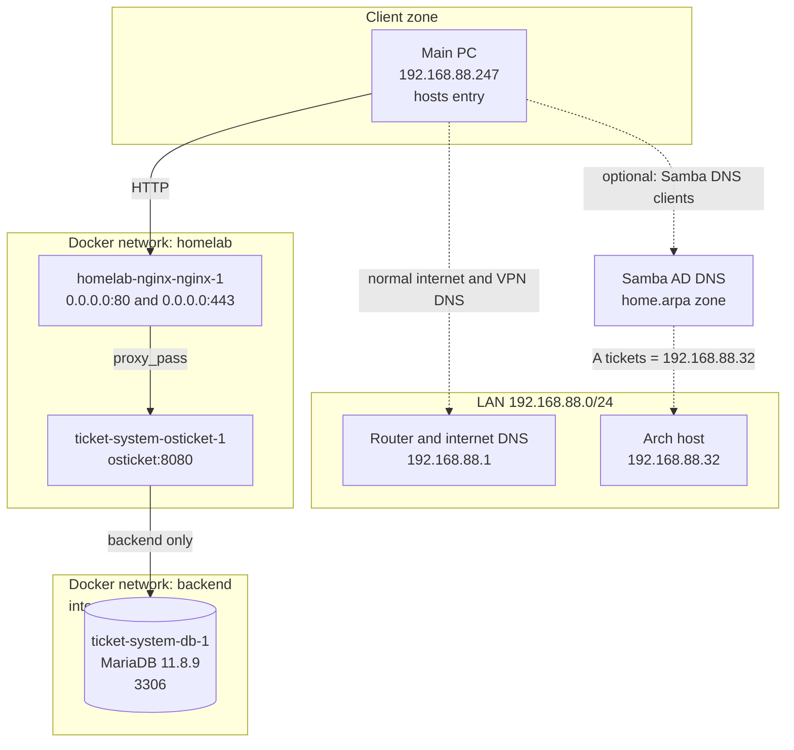
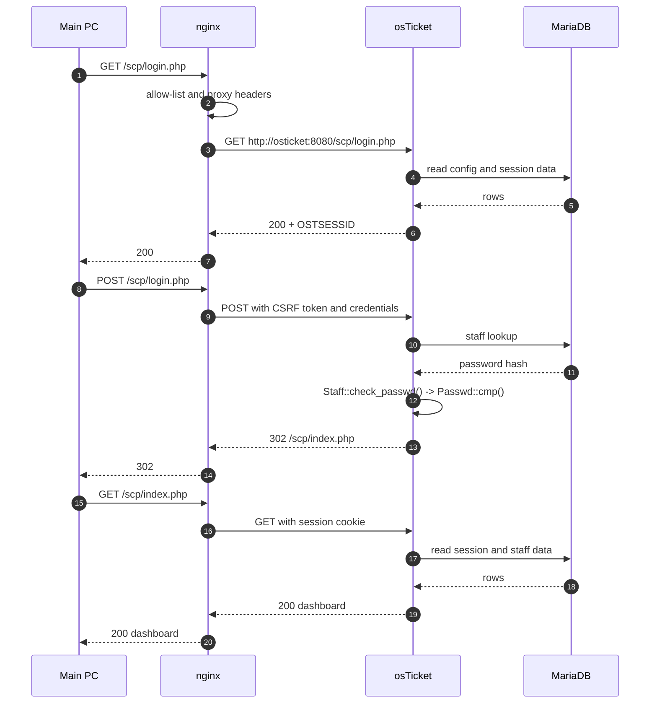
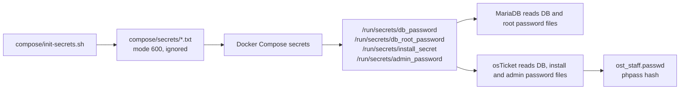

# Architecture

This document explains the design behind the deployment in the top-level
README. It covers the network zones, the request path, the secret flow, the
failure domains and the trade-offs that were made for a small private lab.

## Constraints

The host is an old laptop with 2 cores and 3.7 GiB RAM. It already runs seven
containers, a Samba AD DC and an nginx reverse proxy. The new service had to fit
next to them without:

- publishing a new host port;
- changing the existing nginx, Samba or Docker services;
- putting the database on the shared `homelab` network;
- committing passwords or tokens;
- forcing the main PC to use Samba for all DNS.

The result is deliberately small: two containers, two Docker networks, one
named database volume and one HTTP vhost.

## Network zones



The `homelab` network is external and already existed. The `backend` network is
created by this Compose project with `internal: true`, so containers on it have
no route off the host. MariaDB is attached only to `backend`. The app is
attached to both, because nginx needs to reach it on `homelab` and it needs to
reach MariaDB on `backend`.

The main PC uses a hosts entry instead of changing its global resolver:

```text
192.168.88.32  tickets.home.arpa
```

The Samba DNS A record remains useful for any client that already uses
`dc1.ad.home.arpa` as its resolver. The project does not redirect the whole
main PC to Samba DNS, because that would break internet and VPN name
resolution.

## Request path



The app receives the original client address through `X-Real-IP` and
`X-Forwarded-For`. The nginx block sets `Host`, `X-Forwarded-Proto`,
`X-Forwarded-Host` and `X-Forwarded-Port` so osTicket builds correct links
behind the proxy.

## Two sign-in paths

osTicket exposes two different login forms:

```text
http://tickets.home.arpa/login.php      client portal login
http://tickets.home.arpa/scp/login.php  agent login
```

The top-right **Sign In** link on the client portal points to `/login.php`.
The **I'm an agent - sign in here** link points to `/scp/`. Staff credentials
are checked against `ost_staff`; they are not valid client accounts.

This is a normal osTicket design, but it is easy to hit during a deployment.
The server-side tests in `journal/04-login-access-denied.txt` showed the exact
secret returning `status:302` on the agent endpoint. The browser failure was
the client form, not a bad password. The later password rotation in
`journal/05-admin-password-rotation.txt` is still the active credential, but it
was not the fix.

## Secret flow



The repository contains only `compose/secrets/.gitignore`. The actual secret
files are created on the host, have mode 600 and are ignored by Git. The app
receives file paths, not secret values on the command line. The admin password
is stored as a phpass hash in `ost_staff`; the plaintext value exists only in
the mode-600 secret file.

Changing the admin password is a two-sided operation: update the database hash
and the secret file together. Restoring only one side leaves the account and
the documented credential out of sync.

## Failure domains

| Failure | Effect | What still works | Recovery |
|---|---|---|---|
| nginx container down | The name is unreachable from the LAN | app and database keep running | restart nginx, test `nginx -t` |
| app container down | nginx returns 502 | database keeps running | `docker compose up -d` |
| database down | app returns an error on DB-backed pages | nginx still serves its error path | restart db, check healthcheck |
| database volume lost | tickets and settings are gone | containers start with an empty schema | restore the volume from backup, if one exists |
| Samba DNS down | clients that use Samba DNS cannot resolve the name | main PC with hosts entry still works | restore DNS or use a hosts entry |
| host reboot | all containers restart if Docker starts | named volume persists | check `docker compose ps` after boot |
| secret file lost | the admin password cannot be recovered from the file | the database hash still exists, but there is no plaintext | rotate the password again with a new secret |

There is no HA, replication or automatic failover. The named volume is the only
persistent state in this stack. `docker compose down` keeps it;
`docker compose down -v` deletes it.

## Security boundaries

| Boundary | Control | Residual risk |
|---|---|---|
| Internet to service | no public port; nginx allow list for private ranges | HTTP is unencrypted on the LAN |
| LAN to app | nginx allow list, osTicket login | anyone on the allowed LAN can reach the login page |
| App to database | internal `backend` network, no host port | a compromised app can read the database |
| Container to host | rootless app, `cap_drop: ALL`, `no-new-privileges`, read-only rootfs | kernel and Docker daemon are shared |
| Build to runtime | digest pin, image audit | community image, unsigned, unpinned plugin sources |
| Secrets | mode 600 files, Docker file secrets, not in Git | Docker socket access is root-equivalent |

The app has a read-only root filesystem and writable tmpfs mounts for
`/run/osticket` and `/tmp`. The entrypoint needs `/run/osticket` to create its
runtime configuration and logs. Both tmpfs mounts use `noexec` and `nosuid`;
`/tmp` is mode 1777 and `/run/osticket` is owned by the app user.

## Trade-offs

### Digest pin instead of a self-built image

There is no official osTicket Docker image. The older `osticket/osticket` image
has not been updated since 2020. The chosen `hlhd/osticket:v1.18.4` image was
audited, compared with the official release and smoke-tested before use. It is
pinned by digest so a tag move cannot silently change the runtime.

The trade-off is trust in a community maintainer. A future improvement is to
build and sign an image from the official 1.18.4 zip in this repository.

### HTTP only

The service is on a private LAN and the existing nginx container already
terminates TLS for other services. osTicket was kept on HTTP to avoid managing
another certificate and to keep the scope small. This is a lab limitation, not
a production recommendation.

### Hosts entry for the main PC

Pointing the whole main PC at Samba DNS would make `tickets.home.arpa` resolve,
but it would also move internet and VPN DNS to the DC. A single hosts entry
solves the immediate problem without changing the rest of the resolver
configuration. The cost is that the entry must be maintained on that client.

### Local admin instead of LDAP

LDAP against Samba AD is planned but not implemented. The local admin keeps the
first deployment small and gives a fallback account if directory integration
fails later. The trade-off is another credential to manage and no central
disable path.

### No cron container

The image does not run osTicket's cron internally; upstream expects an external
scheduler. The first deployment left `enable_auto_cron=0` and did not add a
cron container. The trade-off is that mail polling and scheduled tasks are not
running yet.

## What I would change for production

1. Terminate TLS at nginx with a real certificate and redirect HTTP to HTTPS.
2. Add LDAP or SAML against the directory, with a documented break-glass local
   admin.
3. Add a database backup job, restore test and alerting.
4. Run the osTicket cron worker in a separate container or host timer.
5. Build and sign the application image from the official release artifact.
6. Pin plugin sources to commits and rebuild on a schedule.
7. Add monitoring for healthchecks, disk space, certificate expiry and backup
   age.
8. Remove the broad temporary `sudo` rule used during the build.

None of those are claimed as complete in this repository.
